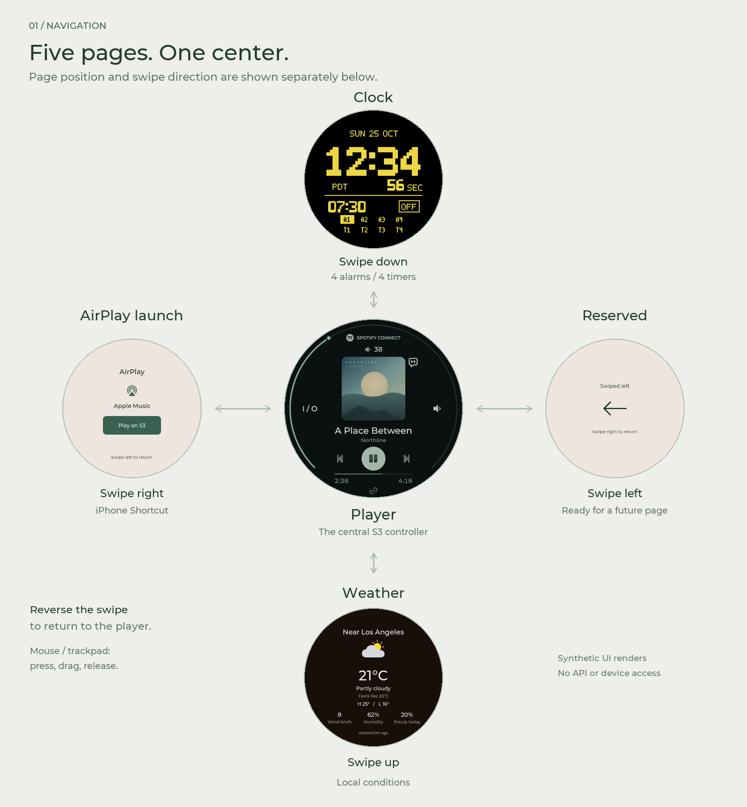
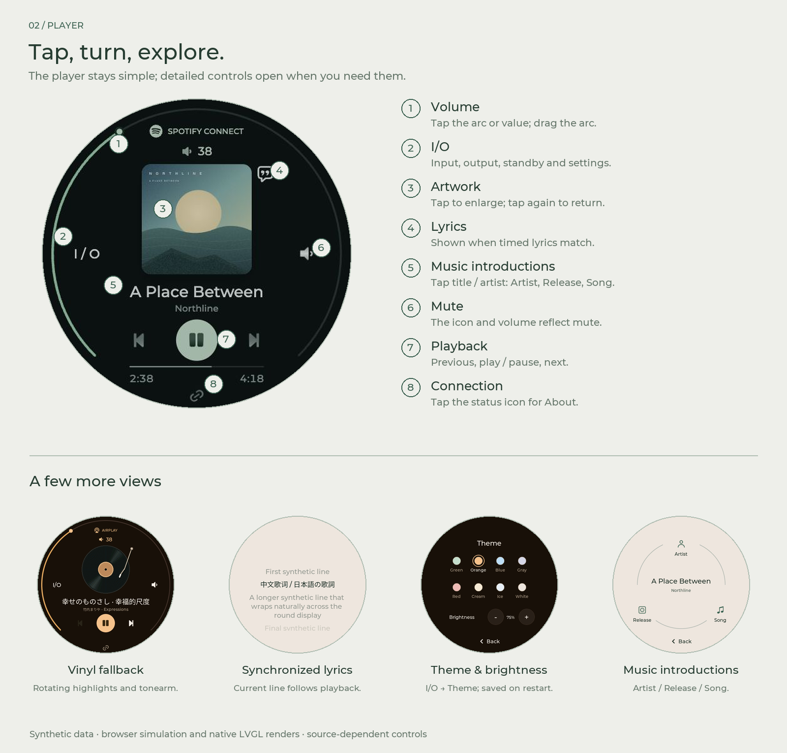

# Fosi S3 Controller

A round-screen controller for the **Fosi Audio S3**, built for the **LilyGO T-RGB
2.1-inch full-circle display** (ESP32-S3, 480 × 480, 16 MB Flash, 8 MB PSRAM).
Fosi S3 Controller is an independent community project, not official Fosi or LilyGO firmware.
It runs on the display; it does not replace the S3's firmware.

**[Try the online simulator](https://bridgee.github.io/fosi-s3-controller/?device=player)** — pure simulation, no real API calls or hardware access.

**Version 0.1.58** · [Clock & timers](https://bridgee.github.io/fosi-s3-controller/?device=blank-up) · [Music introductions](https://bridgee.github.io/fosi-s3-controller/?device=intro)

## Five pages, one controller



From the player, use these gestures: **down for Clock, up for
Weather, right for AirPlay launch, left for the reserved page**. Reverse the
swipe to return. A drag that starts on the volume arc adjusts volume instead.

The grid-aligned pixel clock has **A1–A4 alarms** and **T1–T4 timers**. Select a slot,
tap its time to edit, then SAVE. Alarms use ON / OFF; timers use RST and STRT / PAU.
Alerts light the display and flash until STOP. The idle clock dims and stays visible.

## Inside the player



| Control | Interaction |
| --- | --- |
| Volume | Tap the arc or top volume value to open Volume; drag the arc to adjust. |
| I/O | Select input/output; open About, Theme/brightness or standby. |
| Artwork | Tap to enlarge; tap again to return. |
| Vinyl | With no artwork, a rotating record and tonearm follow playback. |
| Lyrics | A speech-bubble icon appears only after a timed-lyrics match. |
| Music introductions | Tap the title/artist, then choose Artist, Release or Song. Scroll to the Source list. |
| Playback and mute | Use the central transport controls and right-hand mute icon. |
| Connection | Tap the bottom status icon to open About. |

The images use synthetic data.

## Features

- Local S3 discovery, input/output selection, volume, mute, standby and wake.
- Album artwork, enlarged artwork view, playback progress and a vinyl fallback.
- Synchronized lyrics when a sufficiently close timed-lyrics match is available.
- Clock, four independent alarms and four countdowns with visual alerts; weather
  and clock timezone share IP-based location.
- Eight themes, saved brightness, and touch-to-wake display idle. The clock dims
  after inactivity and stays visible; other pages turn off.
- Optional iPhone Shortcut launch and short, source-linked music introductions.
  Both are disabled by default; AI needs your own private OpenAI configuration.

Transport controls follow the capabilities reported by the source. Bluetooth
senders may reject pause/play. HDMI/optical signal lock is not verified by this
controller. The display is a controller, not an AirPlay receiver or Apple Music player.

## Build

Use Python 3.11 or later, Git, and PlatformIO Core:

```sh
python3 -m venv .venv
# Windows: .venv\Scripts\activate
. .venv/bin/activate
python -m pip install -r requirements-dev.txt
python tools/prepare.py
pio run -e orbit-demo
```

The demo needs no credentials. For a live build:

```sh
cp firmware/OrbitS3/config_local.example.h firmware/OrbitS3/config_local.h
# Edit the private copy with your 2.4 GHz Wi-Fi settings.
pio run -e orbit-live
```

An empty S3 URL enables verified mDNS discovery; a manual URL is a fallback.
Numeric volume writes are read-only until a local ceiling is configured.
See [configuration](docs/CONFIGURATION.md) for optional services and limits.
AI setup uses the empty [`ai_local.example.h`](firmware/OrbitS3/ai_local.example.h)
template; follow the [private configuration steps](docs/CONFIGURATION.md#optional-music-introductions).
Never upload private configuration or a credential-bearing firmware binary.

To install on the intended T-RGB display, explicitly select its serial port:

```sh
pio run -e orbit-demo -t upload --upload-port YOUR_DISPLAY_PORT
# Use -e orbit-live only after configuring and checking that build.
```

Do not flash this build to an S3 streamer or an unrelated ESP32 board. A standalone
application `firmware.bin` is not a complete factory image; use PlatformIO upload.

## Local simulator

```sh
python tools/serve_preview.py --port 8765
```

Open [the local simulator](http://127.0.0.1:8765/index.html?device=player).
Use mouse/trackpad press-and-drag or touch swipes; reverse the swipe to return.
A page guide beside the dial explains what to try and how to navigate; on narrow
screens it sits below the dial. It also follows artwork, standby and display sleep.
Both HTML entries use the same guide and simulated controls.

| Page | From the center player |
| --- | --- |
| Clock, alarm, countdown | Swipe down |
| Local weather | Swipe up |
| iPhone / AirPlay launch | Swipe right |
| Reserved page | Swipe left |

On the player, try the volume arc and Volume page, mute, playback buttons and
I/O. I/O opens input/output selection, About, themes/brightness and standby.
Tap artwork to enlarge and tap again to return. Matching timed lyrics expose a
lyrics icon; title/artist open Artist / Release / Song introductions. Completed
introductions have a Source list at the end. These are synthetic local states,
including playback, lyrics, weather, phone launch, AI loading/retry and cache hits.

Useful local scenarios:

- `?device=player&artwork=none` — rotating vinyl and tonearm.
- `?device=player&lyricsTools=1` — lyric matching, failures and timeline controls.
- `?device=intro&introTools=1` — introduction loading, cancel, track change and cache.
- `?device=intro&metadata=long` — long title/artist scrolling.
- `?device=player&power=standby` — standby navigation and wake flow.

The browser reproduces the firmware layout/behavior using shared assets and
checks; **it does not run LVGL**. For actual LVGL raster output and synthetic
pointer interaction tests, after the build setup run:

```sh
python tools/test_ui.py
```

The host harness compiles the production LVGL UI and writes PNG/GIF renders to
ignored `artifacts/`. It tests the central and neighboring pages and nested
controls; it is not a substitute for physical-panel performance testing.
The browser server binds only to loopback, rejects private/source paths and
blocks outbound connections. Neither simulator operates hardware or calls APIs.

## Development

[Development](docs/DEVELOPMENT.md) covers source layout, offline tests and pinned
build dependencies. [Protocol notes](docs/PROTOCOL.md) describe source-dependent
behavior and the community references. The repository includes a local browser simulator and a real LVGL host-rendering
harness. Captured media, personal configuration and device binaries are excluded.

## License and credits

Original project code: [MIT](LICENSE), Copyright (c) 2026 Bridge Zhao.
Third-party components, fonts and data retain their own terms; see
[third-party notices](THIRD_PARTY_NOTICES.md). Weather data are provided by
[Open-Meteo](https://open-meteo.com/) under
[CC BY 4.0](https://creativecommons.org/licenses/by/4.0/); this client formats
model estimates for the display. Public API availability and free-tier terms
can change independently of this firmware.
